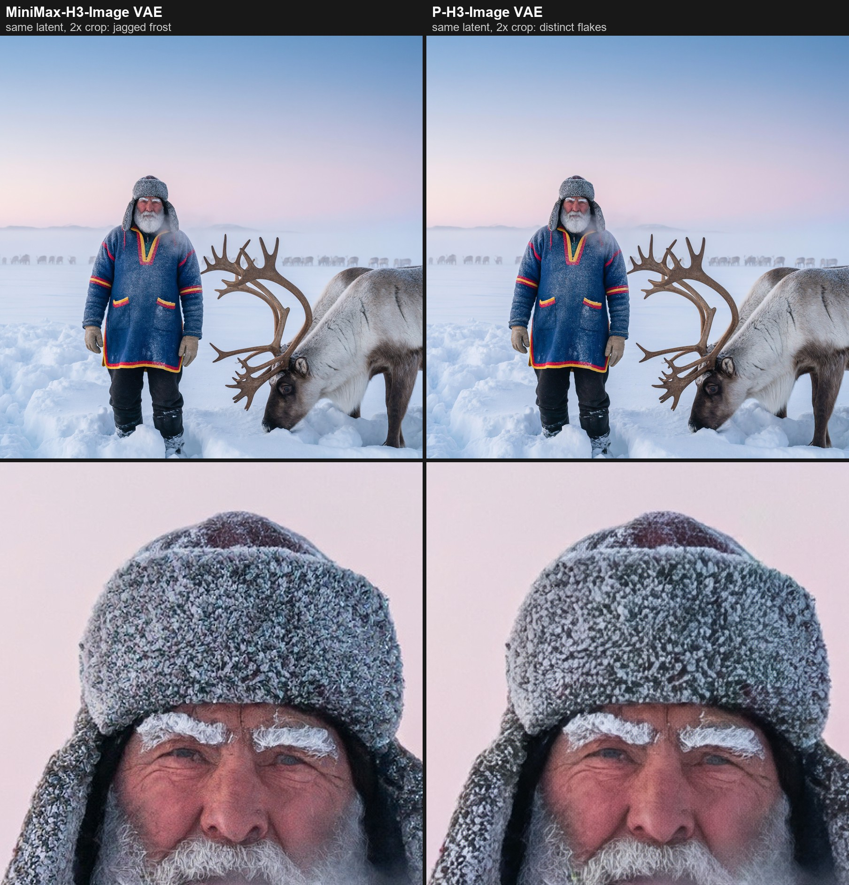
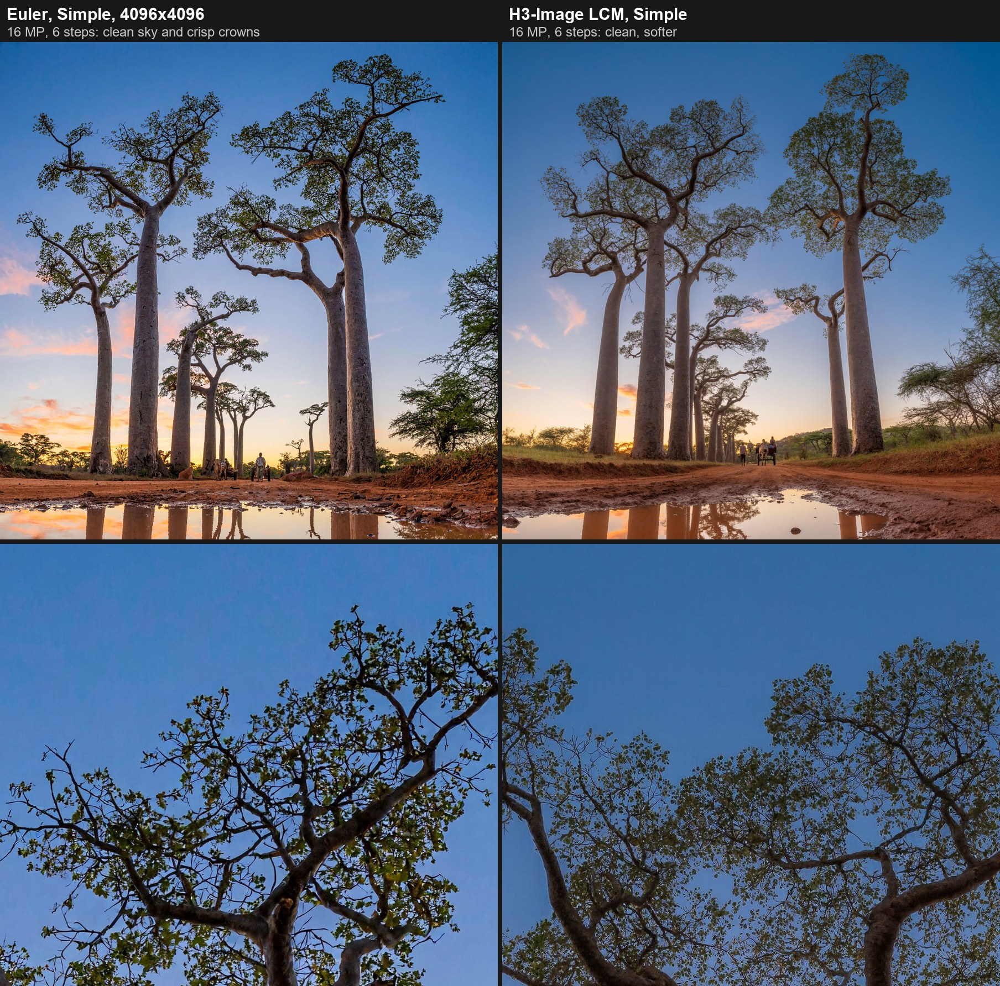
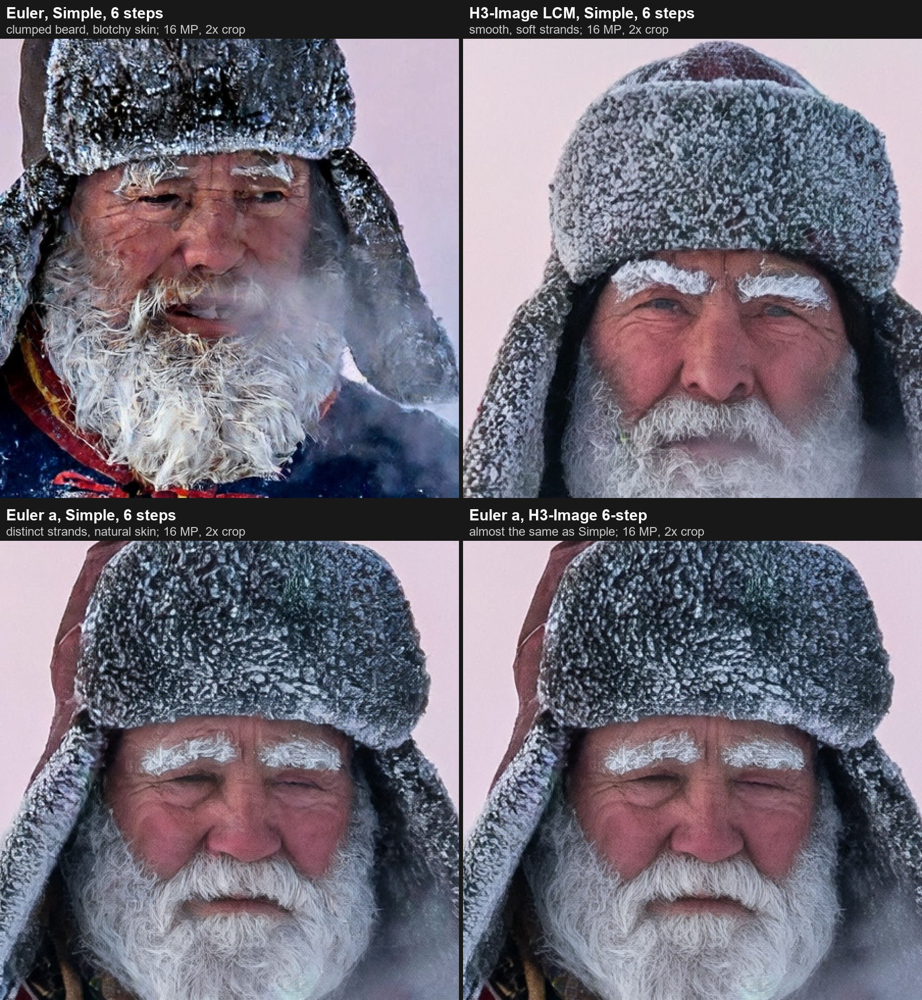
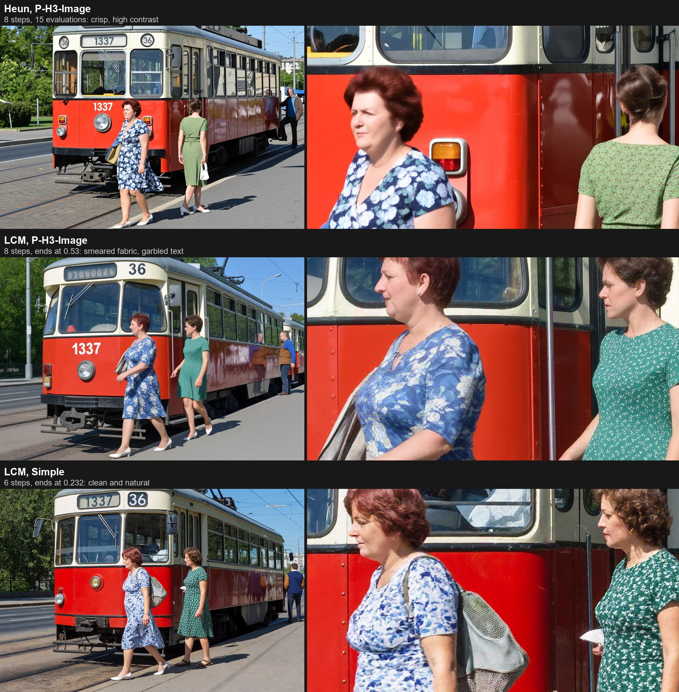
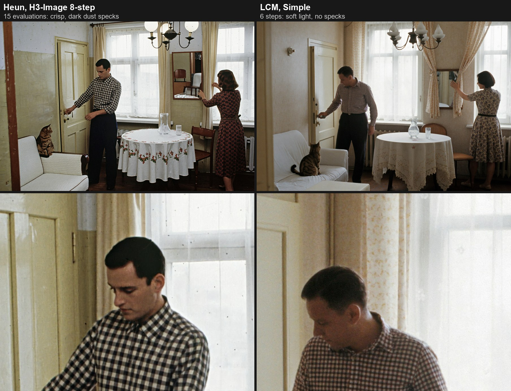
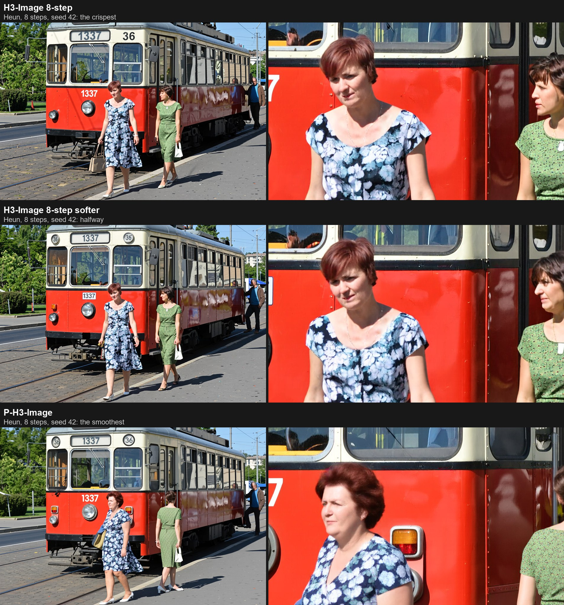
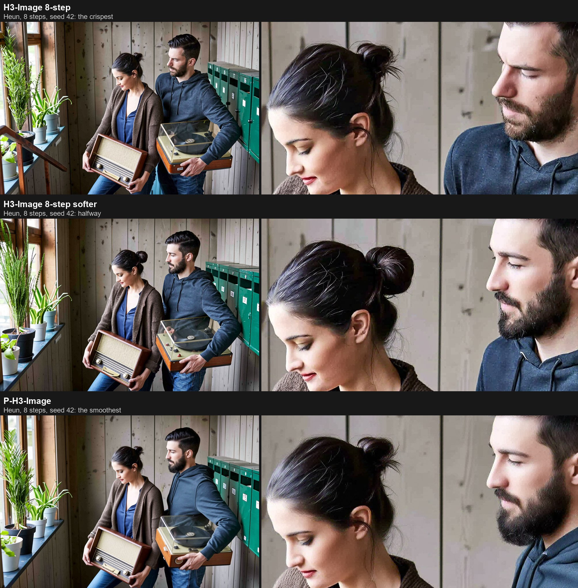
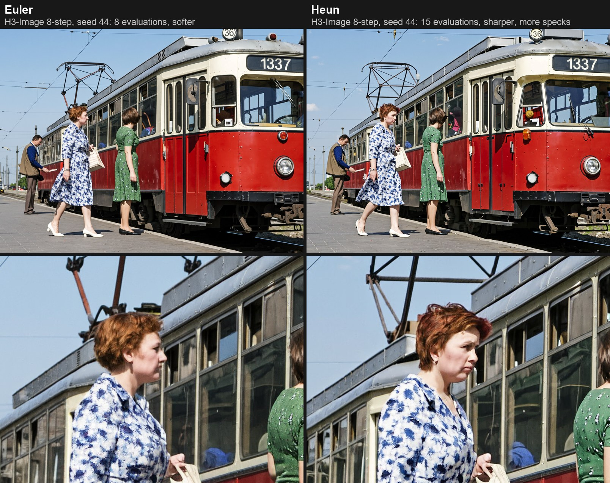
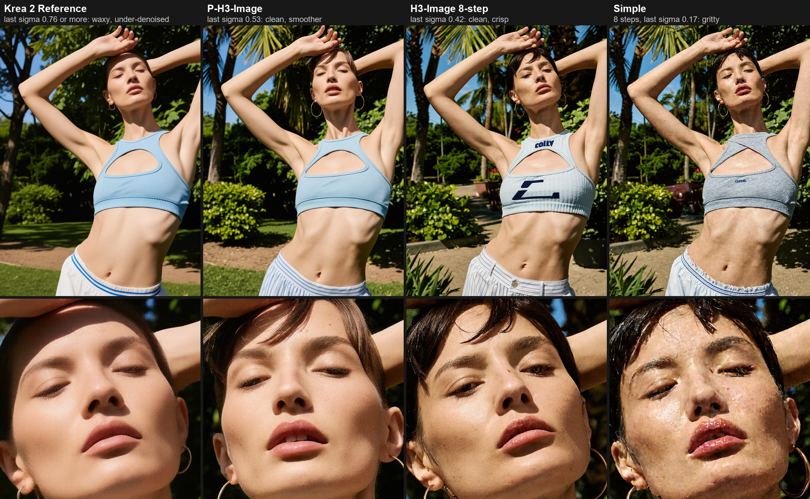
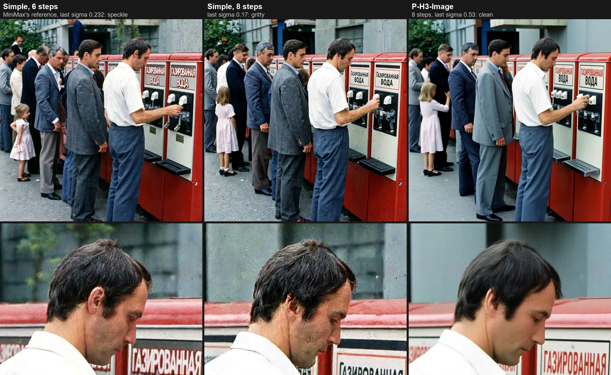

# MiniMax-H3-Image for Forge Neo

[](https://github.com/Haoming02/sd-webui-forge-classic/tree/neo)

[](LICENSE)

An extension for [Stable Diffusion WebUI Forge Neo](https://github.com/Haoming02/sd-webui-forge-classic/tree/neo) that runs MiniMax's [MiniMax-H3-Image](https://huggingface.co/MiniMaxAI/MiniMax-H3-Image) for text-to-image and editing, with the checkpoint selector, presets and Generate button you already know. It also runs Pruna's [P-H3-Image](https://huggingface.co/PrunaAI/P-H3-Image-Comfy), which this extension was first written for, and accepts P-H3-Image's small text encoder in place of MiniMax's 32B one.

> [!Note]
> **A personal note and recommendation, after testing both models on an RTX 5090.** MiniMax-H3-Image supersedes P-H3-Image. With the same prompt, seeds and text encoder, MiniMax-H3-Image wrote the requested numbers correctly in every picture, followed the described poses more closely and gave less fine grain. P-H3-Image dropped or misspelled a number in 5 of 16 pictures and added more garbled signs.
>
> **The part of P-H3-Image that is still worth having is its text encoder.** At 5 GB in INT8 against 27 GB, it stands in for the 32B H3 encoder, and MiniMax-H3-Image follows it well. All my MiniMax-H3-Image tests used it. It is marked experimental because MiniMax did not train the checkpoint with it.
>
> P-H3-Image stays supported. It is still a good **edit-and-upscale** model: in edit mode it does 8 MP and more without running out of memory, in 8 steps, in seconds.
>
> **Use a sampler that adds fresh noise at each step.** MiniMax's reference recipe, Euler with Simple at 6 steps, leaves speckle below about 9 MP, in ComfyUI too, and at 16 MP clumped, painterly texture, like a small sensor with heavy noise reduction. On the same six sigmas, the **H3-Image LCM** sampler (the default) is smooth and clean at every size I tried, and **Euler a** is clean with crisper detail; see [Settings](#settings). Generate at about 16 MP for the most detail, and try P-H3-Image's VAE in place of MiniMax's for finer texture. **Still untested:** MiniMax-H3-Image's edit mode, and the stock MiniMax H3 checkpoint with Pruna's P-H3-Image LoRA.
>
> The repository keeps its old name for now.
>
> This is a fork of [minimax-h3-forge-neo](https://github.com/eduardoabreu81/minimax-h3-forge-neo) with everything video and audio removed: no clips, no sound, no FFmpeg, no keyframes, guides or motion control. The extension needs an up-to-date **Forge Neo** (the `neo` branch, with comfy-kitchen 0.2.37 or later). On an older version it stays disabled and tells you so in the console; Forge Neo itself keeps working as usual.

## What it does

- **MiniMax-H3-Image**, MiniMax's image model: text-to-image and edits with up to 16 pictures, 4 to 20 MP, in 6 steps with no CFG, on MiniMax's own sigma grid with a sampler made for it. Select its checkpoint, the H3 text encoder and its VAE, and pick the `h3image` UI preset.
- **P-H3-Image's text encoder and VAE with MiniMax-H3-Image** (experimental): the text encoder takes 3.6 to 9.1 GB in place of 27 GB; the VAE decodes the same latents with cleaner fine texture. Select either like any other module.
- **P-H3-Image text-to-image** at 8 MP in 8 steps, no CFG, with Pruna's own schedule: select the P-H3-Image checkpoint, text encoder and VAE, pick the `ph3` UI preset and generate.
- **P-H3-Image edits** in img2img: the input image is `<Picture 1>`, the ImageStitch Integrated gallery holds up to 7 references, and the prompt names them.
- **Forge's own machinery**: its loader, samplers, memory management, quantized formats (int8, w4a8, w6a8, fp8, GGUF) and LoRA handling. Nothing is installed into Forge's Python environment.

A generation is one latent frame, decoded as a picture. P-H3-Image's checkpoint has the audio-video layout of MiniMax H3, so it also gets the two-step audio stub it expects, sampled with the picture and never decoded; MiniMax-H3-Image has no audio stream at all. The video VAE and the audio VAE of MiniMax H3 are not used, and are refused if selected.

## Installation

1. In Forge Neo, open **Extensions → Install from URL**.
2. Paste `https://github.com/aoleg/pruna-P-H3-Image-forge-neo`, click **Install** and restart the WebUI.
3. Check the console at startup for `[MiniMax H3] native backend enabled`.
4. Download one set of model files below.

### MiniMax-H3-Image

Files from [Comfy-Org/MiniMax-H3-Image](https://huggingface.co/Comfy-Org/MiniMax-H3-Image).

| Part | File | Size | Folder |
| --- | --- | ---: | --- |
| Checkpoint | `diffusion_models/minimax_h3_image_pruned_bf16`, `_int8_convrot` or `_w4a8` | 40.2 / 21.0 / 12.6 GB | `models/Stable-diffusion` |
| Text encoder | `text_encoders/qwen3vl_32b_minimax_h3_int8_convrot` (the MiniMax H3 text encoder; Merserk's INT4 and unsloth's GGUF work too) | 27.1 GB | `models/text_encoder` |
| VAE | `vae/minimax_h3_image_vae_fp16` | 1.2 GB | `models/VAE` |

The checkpoint is the H3 DiT without the audio layers, with six output heads, one per step of MiniMax's own 6-step schedule: CFG 1, no negative prompt. It works from about 4 MP to 20 MP and is best around 16 MP (4096×4096, 4736×3552, 5024×3360, 5472×3072, 6272×2688 and their portrait forms); ComfyUI's node defaults to 2048×2048.

The checkpoint asks for comfy-kitchen's INT8 attention, which ComfyUI then uses; in Forge Neo that is the `--use-ck-attention` launch flag. Without it the model runs on Forge's default attention, slower and with more VRAM at these sizes.

**Experimental:** P-H3-Image's much smaller text encoder (`p-h3-image_text_encoder_*`, 3.6 to 9.1 GB) is accepted in place of the 32B one. Pruna distilled it to stand in for the H3 encoder, and there are reports that MiniMax-H3-Image follows it, but the checkpoint was not trained with it. The console, the panel and the infotext mark such a generation as experimental. Sampling and sizes stay MiniMax-H3-Image's.

**Experimental:** P-H3-Image's VAE (`p-h3-image_vae_*`) is accepted in place of `minimax_h3_image_vae_fp16`, with either text encoder. The two VAEs share the H3 encoder and latent statistics and differ only in the decoder, so the P-H3-Image VAE reads the checkpoint's latents as they are. On the same latent it draws fine texture more cleanly: frost, fur and foliage come out as distinct detail where MiniMax's VAE leaves jagged, pixel-level edges. Composition and colour do not change (the P-H3-Image VAE is about one level darker), and faces look almost the same. It is 3.1 GB in INT8 or 5.6 GB in bf16 against 1.2 GB, and it is marked as experimental like the text encoder.



**Community merge: [FineView](https://civitai.com/models/3045885/fineview-or-h3image).** This is a MiniMax-H3-Image merge with output heads taken from MiniMax H3 (the video model), so that they no longer depend on the 6-step grid. It loads here as MiniMax-H3-Image, with the same text encoders and VAEs. Its author recommends shift 5 at 8 steps (4.44 at 4 MP). This extension ignores the Shift slider, and **H3-Image 8-step** is practically the same curve, so use it with **Euler a**. H3-Image LCM with Simple also works and is softer. Do not use Simple at 8 steps with Euler or Euler a: on this grid it ends at sigma 0.17, and the pictures come out botched. In a one-seed test against the stock INT8 checkpoint on matched settings, FineView was clearly cleaner at 4 MP (2048×2048): with Euler a and with H3-Image LCM, the stock fur and beard came out scratchy and crunchy, and FineView's came out smooth. At 16 MP the difference was small, slightly softer fur with Euler a. Civitai lists it under the MiniMax H3 Community License.

Not used here: the `qwen3.5_9b_w4a8_gptq` prompt enhancer (the model expects a detailed English description of the whole picture, so write one or expand the prompt elsewhere), and the `nvfp4_awq` text encoder, which this extension still refuses because it encoded prompts wrongly in Forge Neo when last tried.

Its license is the MiniMax-H3-Image Community License, not MiniMax H3's: read it before commercial use.

### P-H3-Image

Files from [PrunaAI/P-H3-Image-Comfy](https://huggingface.co/PrunaAI/P-H3-Image-Comfy). Pick one file per part; precisions can be mixed.

| Part | Folder | bf16 | int8 (`int8_convrot`) | w4a8 |
| --- | --- | ---: | ---: | ---: |
| Checkpoint `p-h3-image_*` | `models/Stable-diffusion` | 40.5 GB | 21.2 GB | 13.4 GB |
| Text encoder `p-h3-image_text_encoder_*` | `models/text_encoder` | 9.1 GB | 5.1 GB | 3.6 GB |
| VAE `p-h3-image_vae_*` | `models/VAE` | 5.6 GB | 3.1 GB | (use int8) |

Pruna's own figures for ComfyUI: the bf16 set peaks at about 56 GB of VRAM at 8 MP, the int8 set at 31 GB, the w4a8 set with the int8 VAE at 21 GB. Forge Neo offloads what does not fit, at a cost in speed.

If you already have a MiniMax H3 FL2VA checkpoint, the 2 GB `loras/p-h3-image_lora_bf16.safetensors` applies P-H3-Image to it: select the H3 checkpoint, the P-H3-Image text encoder and VAE, and add `<lora:p-h3-image_lora_bf16:1>` to the prompt.

The **prompt upsampler** of Pruna's workflows (a Qwen3.5-9B text generator) is not part of this extension. P-H3-Image is sensitive to prompting: write full, specific prompts, or run the upsampler elsewhere and paste its output.

### MiniMax H3 itself

Up to 0.9.x an `h3` preset ran a MiniMax H3 video checkpoint with its own 32B text encoder and video VAE as a still-image model, for fine-tune LoRAs such as chroma-h3. It was never tested on a GPU, and MiniMax-H3-Image makes it redundant, so 0.10.0 removes it together with the video VAE. An H3 audio-video checkpoint still runs behind the P-H3-Image text encoder and VAE, as described above; with the 32B text encoder it is refused with a message that says what to select.

## Settings

Selecting a checkpoint applies the matching profile's sampler, schedule and CFG, and the UI presets carry the rest:

| | `h3image` preset: MiniMax-H3-Image | `ph3` preset: P-H3-Image |
| --- | --- | --- |
| Sampler, schedule | **H3-Image LCM**, Simple (MiniMax's grid) | Euler, **P-H3-Image** (Pruna's 8-step grid) |
| Steps, CFG | 6, 1 | 8, 1 |
| Shift | not used (slider hidden) | 1 |
| Size | 4 to 20 MP, best about 16 MP | about 8 MP: 2912×2912, 3360×2496, 3872×2176 |

### The H3-Image LCM sampler

Euler and Heun carry the model's own noise estimate from step to step. LCM instead takes the model's clean estimate at each step and adds fresh random noise for the next one. Below about 16 MP, MiniMax-H3-Image's last output heads turn the carried noise into speckle and grit, but handle fresh noise cleanly. So with LCM, MiniMax's own grid works at any size: Simple at 6 steps ends at sigma 0.232 and comes out clean.

**H3-Image LCM** is LCM with a noise scale that falls from 1.10 at the first step to 0.90 at the last, the setting of a community ComfyUI workflow. Forge's own **LCM** keeps the scale at 1. Both draw their noise from the image's seeded generator, as Forge's other noise-adding samplers do.

Tested with Forge's own LCM on three prompts and four seeds at 3648×2432 (the noise ramp itself is not yet compared):

| | LCM, Simple | Euler or Heun, at this size |
| --- | --- | --- |
| 6 steps, ending at 0.232 (MiniMax's grid) | clean, natural skin, text as reliable as with Euler | speckle |
| 8 steps, ending at about 0.17 | clean, slightly more defined | gritty |
| P-H3-Image schedule, ending at 0.53 | smeared fabric and garbled text | clean with Heun, the smoothest |
| Model evaluations | 6 (8 at 8 steps) | Euler 8, Heun 15 at 8 steps |

With LCM the picture is the model's clean estimate from the last step, so the last sigma should be low: the opposite of the Euler rule in the table further down.

At 16 MP (4096×4096) Euler with Simple at 6 steps loses the speckle, with the same INT8 checkpoint and P-H3-Image text encoder: the model is tuned for that size. At 100% the same flaw shows in another form, as clumped, painterly texture: beards break into flat tufts and skin turns blotchy, like a photo from a small sensor with heavy noise reduction. At a distance, as in the skies and crowns below, it reads as crisp.



**Euler a** avoids the clumping. It adds fresh noise at each step too, about 70 to 85% of what the next output head sees on Simple at 6 steps, so its last steps get noise close to what the heads were trained on. At 16 MP it sits between the two: beards keep distinct strands, skin looks natural, and frost and fur have more bite than with LCM. On Simple and on H3-Image 6-step it gives almost the same picture (a mean difference of 2 of 255), so with Euler a the last sigma hardly matters.





LCM pictures are softer and lower in contrast than Heun's. Heun is crisper, but it leaves small dark specks in bright areas, like dust on a scanned slide:



### Other samplers

Samplers that add fresh noise at each step also avoid most of Euler's speckle, each with its own look. Tested on the street scene with two seeds at 3648×2432, and on a portrait at 16 MP:

| Use | Sampler, schedule | Look |
| --- | --- | --- |
| Default | **H3-Image LCM**, Simple, 6 steps | natural, clean, the fastest |
| Crisper | **Euler a**, Simple, 6 steps | clean and natural with more bite: distinct hair strands, bold frost and fur |
| MiniMax's reference | **Euler**, Simple, 6 steps | speckle below about 9 MP; at 16 MP clumped, painterly texture at 100% |
| A little crisper, 8 steps | **Euler a**, H3-Image 8-step, 8 steps | clean and natural, crisper faces, text as reliable |
| Vivid | **ER SDE**, any schedule | saturated and the sharpest, but over-processed: haloed reflections, warped background faces, more text mistakes |
| Crisp | **Heun**, an H3-Image schedule | crisp, with dark dust specks in bright areas; 15 evaluations |

Euler a on Simple at 6 steps left faint pale blotches in a bright window on one picture of the room scene at 3648×2432; at 16 MP and on H3-Image 8-step none were seen. DPM++ SDE, DPM++ 2M SDE and DPM++ 3M SDE run (they gave NaN before 0.12.1) but are not compared here.

### The H3-Image schedules, for Euler and Heun

For Euler and Heun, MiniMax-H3-Image has three schedules of its own, each named for the step count it was tuned at. Each ends at sigma 0.42, above the range where those samplers fail:

| Schedule | Steps | What it is | Result |
| --- | ---: | --- | --- |
| **H3-Image 8-step** | 8 | a shifted flow curve from sigma 1 to 0.42, then 0 | the crispest |
| **H3-Image 8-step softer** | 8 | the same 0.42 end with a slower start: each sigma halfway between the 8-step curve and Pruna's grid | smoother skin and fewer dark specks, faces still defined |
| **H3-Image 6-step** | 6 | MiniMax's own six-point grid with its last point lifted from 0.232 to 0.42 | clean, three quarters of the time |

The first sigmas decide how smooth the picture is, and the last one barely matters. From crisp to smooth, the order is H3-Image 8-step, H3-Image 8-step softer, then the P-H3-Image schedule. The first sigmas also choose the composition: at 8.9 MP the three kept the same one on seed 42, as below, but at 6.4 MP they often gave different ones.

The same seed and prompt on the three schedules, with Heun at 3648×2432. Each row shows the whole picture and a 1:1 crop; open the image to see the crop at full size.





**Heun** at 8 steps (15 model evaluations against Euler's 8) gives sharper faces than Euler on all three, with more small dark specks that look like dust on a scanned slide. Euler is twice as fast.



Each runs at any other step count too: the list is resampled between its two fixed ends, so 10 or 12 steps of the 8-step schedule sample the same curve more finely and never go below its last sigma. More steps are different, not better: 12 steps gave more skin texture and blemishes than 8. The step count also changes the composition, because the first sigmas choose it.

These schedules are a personal pick from same-seed tests on an RTX 5090 (Euler, CFG 1, 6.4 MP, the INT8 checkpoint with P-H3-Image's text encoder). At that size, with Euler, what decides the picture is the lowest sigma the model is evaluated at (at 16 MP, Simple at 6 steps is clean as well):

| Last sigma before 0 | Schedules that end there | Picture with Euler |
| --- | --- | --- |
| 0.76 and up | Krea 2 Reference, Flux2 (at this size) | under-denoised, down to a blur |
| 0.53 | P-H3-Image, MiniMax's grid without its last point (5 steps) | clean, smoother, a little more grain |
| 0.27 to 0.42 | the three H3-Image schedules, Linear Quadratic, Qwen Image 2.1 Turbo | clean and crisp, nearly the same picture across the range |
| 0.232 | Simple at 6 steps, which is **MiniMax's reference recipe** | speckle (clean with LCM, and with Euler at 16 MP) |
| below 0.2 | Simple, SGM Uniform, Beta, Bong Tangent and Normal at 8 steps | gritty: leathery skin, noise in flat areas (Simple at 8 steps is clean with LCM) |

Four rows of the table on one seed with Euler at 6.4 MP, with a 1:1 crop of the face below each picture:



MiniMax's reference recipe, Simple at 6 steps, against Simple at 8 steps and the P-H3-Image schedule, with Euler at 8.7 MP:



Every Forge schedule is mapped onto the sigma grid stored in the checkpoint, and Simple at 6 steps gives exactly the six sigmas its output heads were made for, so the reference recipe is one sampler away. The failure is not this port's: MiniMax's own ComfyUI workflow, run in SwarmUI, gives the same speckle, and MiniMax's diffusers scheduler takes an Euler step as well. It comes from Euler below 16 MP: LCM on the same sigmas is clean at any size, and so is Euler at 16 MP. The P-H3-Image schedule is Pruna's own sigma grid and ignores Shift; another step count resamples the same curve. Batch Size stays 1 (use Batch Count); Hires. fix and the Refiner are hidden while an H3 checkpoint is selected.

### Output scale

The H3 VAEs decode each latent position into a 16×16 block of pixels, twice the side of most image models' VAEs, so much of the finest texture is invented by the decoder and can look gritty or "upscaled" at 100%. **Settings → MiniMax H3 → [H3] Output scale** shrinks each side of the decoded picture to **3/4**, **2/3**, **1/2** or **1/4** with an exact area filter before Forge saves it: each output pixel is the mean of the source area it covers. From a 16 MP picture (4096×4096), 3/4 gives 9.4 MP (3072×3072), 2/3 gives 7.5 MP (2731×2731) and 1/2 gives 4.2 MP (2048×2048). 1/2 is the cleanest and crispest per pixel; 3/4 and 2/3 also clear the decoder's cross-hatched texture and keep more pixels, a little softer per pixel. A side that does not divide is rounded to the nearest pixel, which shifts the aspect ratio by less than 0.05%. The infotext records the setting; its Size stays the generated size. The setting averages away the decoder's pixel-level texture but not the sampler's speckle or clumping, which are larger than a pixel: for those, use H3-Image LCM or Euler a.

## Editing

**Settings → MiniMax H3 → [H3] Enable Reference** (on by default, like Forge's Klein and Krea 2 settings) decides what img2img does. On, it is an edit, with MiniMax-H3-Image or P-H3-Image:

- the input image is `<Picture 1>`, the picture to edit;
- turn on **ImageStitch Integrated** and add the references to its gallery: `<Picture 2>`, `<Picture 3>` and so on, 16 pictures in all for MiniMax-H3-Image, 8 for P-H3-Image;
- write the instruction and name the pictures ("put the hat from <Picture 2> on the person in <Picture 1>");
- Width and Height set the output. Resize mode and Denoising strength are not used: the model generates the whole picture from noise, conditioned on the pictures.

The two models take the pictures their own way, as their ComfyUI nodes do:

| | MiniMax-H3-Image | P-H3-Image |
| --- | --- | --- |
| Picture for the VAE | short edge brought into 1024 to 2048 | within the output area, never enlarged |
| Picture for the text encoder | short edge 1024 | within 1 MP |
| Prompt | used as written | a short instruction gets `Edit <Picture 1>. ` in front; one that already starts that way, or an edit brief from Pruna's upsampler, is used as it is |
| Good output size | 4 MP and up | about 4 MP (2048×2048, 2368×1760, 2720×1536) |

Every reference adds its own tokens to the sequence: sixteen large pictures are a much longer run than one.

Off, img2img is Forge's own with either model: the input image is encoded, noised at Denoising strength and denoised on the profile's schedule. With MiniMax-H3-Image the schedules stop at sigma 0.42 or above, so even a low Denoising strength starts from a heavily noised picture: gentle refinement is not what this mode does.

## Known unknowns

- MiniMax-H3-Image with P-H3-Image's text encoder is an experiment: one same-seed comparison gave a similar composition with different small details, and all the schedule tests above used it.
- MiniMax-H3-Image runs at up to 16 MP, with either text encoder and either image VAE. Its reference recipe (Euler, Simple, 6 steps) is clean at 16 MP and leaves speckle below about 9 MP, in ComfyUI too; the H3-Image LCM sampler avoids it at any size. It has not been tried for edits.
- The working-memory reservation is an estimate (the console prints the measured figure on the first step of every generation).
- The stock MiniMax H3 checkpoint with Pruna's LoRA has not been run yet.
- P-H3-Image's text-to-image is soft in small detail at every size tried. The sampling path matches ComfyUI's stage by stage, and the launch flags that lower precision made no difference, so the comparison left is the same prompt in ComfyUI.

## Local tests (developers)

```bash
python -m unittest discover -s tests -v
python -m ruff check .
```

The tests use the real tensor names and shapes of the published files (`tests/fixtures/h3_headers.json.gz`, no weights) and stand-ins for Forge Neo (`tests/forge_stubs.py`). They do not replace a GPU run.

## Credits

- **[minimax-h3-forge-neo](https://github.com/eduardoabreu81/minimax-h3-forge-neo)** by Eduardo Abreu, the video extension this fork starts from
- **[Forge Neo](https://github.com/Haoming02/sd-webui-forge-classic/tree/neo)** by Haoming02
- **[MiniMax H3](https://github.com/MiniMax-AI/MiniMax-H3)** and **[MiniMax-H3-Image](https://huggingface.co/MiniMaxAI/MiniMax-H3-Image)** by MiniMax
- **[Pruna AI](https://huggingface.co/PrunaAI/P-H3-Image-Comfy)**: P-H3-Image
- **[ComfyUI](https://github.com/Comfy-Org/ComfyUI)**: reference implementation of the models
- **[Comfy-Org](https://huggingface.co/Comfy-Org/MiniMax-H3-Image)**: the MiniMax-H3-Image and H3 model files
- **[Kijai](https://huggingface.co/Kijai)**: the W4A8 checkpoints
- **[Merserk](https://huggingface.co/Merserk/MiniMax-H3-INT4-ConvRot)**: the INT4 text encoder
- **[unsloth](https://huggingface.co/unsloth/MiniMax-H3-GGUF)**: GGUF checkpoints

## License

AGPL-3.0, see [LICENSE](LICENSE). The model weights have their own terms: MiniMax-H3-Image is under the MiniMax-H3-Image Community License (separate authorization above a revenue threshold or for hosted services); P-H3-Image and MiniMax H3 are under the MiniMax H3 Community License, which excludes some regions and requires "Powered by MiniMax H3" on products built with them; the Qwen3-VL parts of P-H3-Image's text encoder are Apache 2.0.
